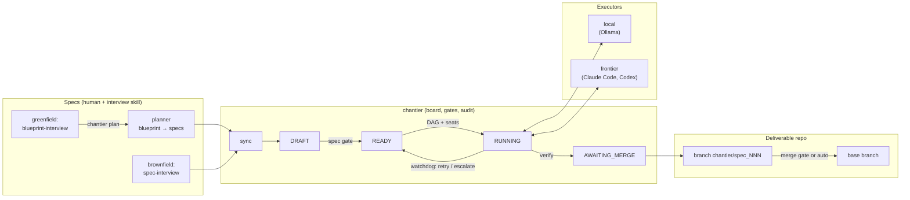

# chantier — An opinionated, spec-driven code factory

> **chantier** (French, pronounced *shahn-tyay*): a construction site, a building site. The place where a foreman dispatches the work to the trades, inspectors sign off at set milestones, and the plans decide what gets built. Here, the plans are specs, the trades are local and frontier coding agents, and the inspections are the factory's gates.

*An opinionated, spec-driven code factory.* Humans decide **what** to build and approve it at two gates; agents build it. Local LLMs do the bulk of the work, frontier agents do the heavy lifting and take over when a local model goes off the rails, and every dollar spent (or saved) is accounted for.



## What it does

- **Spec-driven, both ways in.** Greenfield starts with the `blueprint-interview` skill and a frontier planner that turns the blueprint into specs with dependencies. Brownfield starts with `spec-interview` ([esavard/agent-skills](https://github.com/esavard/agent-skills)). Both produce the same spec format, and from there the pipeline is identical.
- **The deliverable is a separate repo.** No side-car. chantier works in its own clone and worktrees; the deliverable only ever receives branches.
- **Deterministic routing with escalation.** A ladder per ticket kind: `implement: [ollama, claude]` means local first, frontier after two failed attempts. Escalation measures difficulty instead of guessing it.
- **A supervisor that catches a local model going in circles.** Loop detection, idle and hard timeouts, then retry or escalate. Frontier work starts from a clean branch, not from the local model's mess.
- **Verification, not claims.** After every attempt: the spec text is unchanged except its checkboxes, every checkbox is resolved (`[x]`, `(manual)` or `NOT DONE: <reason>`), changed files stay inside the spec's declared paths, and the project's own checks pass.
- **Auto-advance with gates where they matter.** Spec approval and merge are `human` or `auto` per project. Everything in between moves on its own. Parallel where the dependency graph allows, within each executor's seats.
- **Notifications only when a human is needed.** Gate waiting, escalation exhausted, budget reached. Console and Telegram.
- **Cost control and an honest savings figure.** Per-project daily frontier budget. Savings count only successful local work that was never redone on the frontier, minus GPU energy.
- **Upgradable without disturbing work in progress.** State lives in the factory (SQLite, migrations), tickets record their workflow version, and `chantier drain` finishes running work before an upgrade.
- **Ports for what comes next.** External trackers (Jira, GitHub Issues), remote dashboard sync, other executors: each is an adapter behind a port that already exists.

## Quick start

You work in two places:

- **the deliverable repo**: where you run the interview skills (with Claude Code or Codex) and commit specs. chantier never writes there, except branches and merges.
- **any terminal**: `chantier` commands run from any directory. The factory's config and state live in `~/.chantier`, not in the current folder.

Placeholders:

- `<project>`: the name you give the repo in chantier (e.g. `billing-api`). Tickets are named `<project>/<spec_NNN_name>`.
- `<path/to/repo>`: the deliverable repo's local path, or its git URL.
- `<spec_NNN_name>`: a spec file name without `.md` (e.g. `spec_004_history`).
- `<your test command>`: the command that proves the deliverable still works, the one you would run before opening a PR. chantier runs it in the ticket's worktree after every attempt; a non-zero exit code fails the attempt and its output becomes feedback for the next one. Examples: `uv run pytest -q`, `npm test`, `./gradlew test`, `go test ./...`, `flutter test`. Repeat `--check` for several commands (tests, linter, architecture rules); all must pass. You can change them later in `~/.chantier/projects/<project>.yaml` under `checks:`. Without any check, chantier only verifies the spec (checkboxes, integrity, scope), so set at least your test suite.

### Install, once

```bash
uv tool install --from git+https://github.com/esavard/chantier 'chantier[web]'
chantier init          # writes ~/.chantier/config.yaml: edit executors, routing, pricing
```

### Brownfield: an existing repo

```bash
# 1. In the deliverable repo: write a spec by interview, then commit it on the base branch
cd <path/to/repo>
claude                 # run the spec-interview skill (once: spec-conventions-interview if CONVENTIONS.md is missing)
git add docs/specs && git commit -m "docs: <spec_NNN_name>"

# 2. From any terminal: register the repo once, then approve the spec
chantier add <project> --repo <path/to/repo> --check "<your test command>"   # also imports existing specs
chantier sync <project>                       # later specs: imports new docs/specs/spec_*.md as DRAFT
                                              # (a running factory also syncs on its own every cycle)
chantier approve <project>/<spec_NNN_name>    # gate 1: the spec is final

# 3. From any terminal: run the factory
chantier serve --run   # web board on http://localhost:8765 (or: chantier run, terminal only)

# 4. When the ticket reaches "To merge": review branch chantier/<spec_NNN_name> in the deliverable repo, then
chantier approve <project>/<spec_NNN_name>    # gate 2: merge (or merge it yourself; chantier notices)
```

### Greenfield: a new repo

```bash
# 1. Create the deliverable repo and write the blueprint by interview
mkdir <path/to/repo> && cd <path/to/repo> && git init -b main
claude                 # run the blueprint-interview skill: writes docs/blueprint.md
git add docs/blueprint.md && git commit -m "docs: blueprint"

# 2. From any terminal: register the repo and ask for a plan
chantier add <project> --repo <path/to/repo> --check "<your test command>"
chantier plan <project>                  # creates ticket <project>/plan_001; the blueprint is its spec
chantier approve <project>/plan_001      # gate 1: the blueprint is final
chantier serve --run                     # a frontier planner writes the specs on branch chantier/plan_001

# 3. Review the proposed specs on branch chantier/plan_001, then
chantier approve <project>/plan_001      # gate 2: merge the specs
# the running factory imports them and builds them in dependency order, exactly like brownfield
```

Everyday commands:

| Command | What |
|---|---|
| `chantier board [project] [--watch]` | kanban in the terminal |
| `chantier serve [--run]` | web board + HTTP API (localhost) |
| `chantier attention` | what needs a human |
| `chantier show <ticket>` | transitions, runs, feedback |
| `chantier approve / reject / unblock <ticket>` | gates |
| `chantier metrics [project]` | spend, local share, savings |
| `chantier drain` / `resume` | before / after upgrading the factory |

## Configuration

`~/.chantier/` (override with `CHANTIER_HOME`):

```
config.yaml              executors, routing ladders, pricing, energy, notifications
projects/<name>.yaml     repo, base_branch, pack, gates, checks, review, scope_mode, budget
packs/<name>/            private packs: defaults + prompt overrides (prompts/implement.md, ...)
chantier.db              state
workspaces/ logs/ events.jsonl
```

A project file:

```yaml
repo: <path/to/repo>         # or a git URL
base_branch: main
pack: generic
gates: {spec_approval: human, merge: human}
checks: ["uv run pytest -q", "uv run lint-imports"]
review: false                # true: a frontier review run after verification
scope_mode: warn             # warn | enforce | off   (files outside the spec's declared paths)
frontier_budget_usd_per_day: 5
```

See [`src/chantier/config.example.yaml`](src/chantier/config.example.yaml) for executors and routing.

## Spec format

chantier reads the format produced by `spec-interview`. It needs three things from a spec, all optional except the checkboxes:

```markdown
## 2. Context
**Relevant modules/paths:** `lib/history/`, `lib/app.dart`     <- blast radius (scope check)
**Depends on:** spec_001_basic_calculator                       <- scheduling order

## 4. Requirements
- [ ] REQ-001 ... — Acceptance: ...                               <- verified checkboxes
```

`Depends on` is a chantier addition; specs without it simply have no dependencies.

## Documentation

- [docs/ARCHITECTURE.md](docs/ARCHITECTURE.md): layers, ports, ticket lifecycle, verification, metrics
- [docs/adr/0001-pivot-from-sovereignspecai.md](docs/adr/0001-pivot-from-sovereignspecai.md): why this repo exists and what came from where
- [docs/ROADMAP.md](docs/ROADMAP.md): ports without adapters yet, known limits
- [CONVENTIONS.md](CONVENTIONS.md): engineering rules of this repo

## Development

```bash
uv sync --extra web
uv run pytest -q          # unit + end-to-end scenarios on real git repos with scripted agents
uv run lint-imports       # architecture contracts (layers, pure domain)
```

## License

[MIT licensed](LICENSE).
