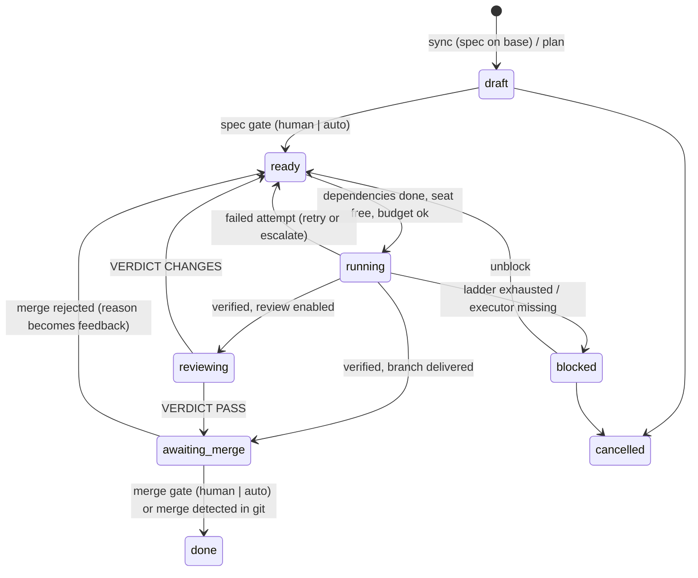

# Architecture

Hexagonal. The domain and the application services know nothing about git, SQLite, subprocesses, YAML, Rich or FastAPI; adapters implement ports. `uv run lint-imports` enforces it.

```
chantier.cli        chantier.api           clients (terminal, web/HTTP)
        │                │
   chantier.bootstrap                      composition root: the only module that knows every adapter
        │
chantier.adapters                          sqlite store, git workspace, executors, config, notifiers, sinks
        │
chantier.application                       board (gates, transitions), scheduler, supervisor, verification, metrics, ports
        │
chantier.specs                             spec parsing, integrity hash
        │
chantier.domain                            tickets, workflow, routing, economics   (no I/O)
```

## Where things live

| Thing | Where | Why |
|---|---|---|
| Factory code | this repo, installed as a tool | upgrading it never touches a deliverable |
| Factory config and state | `$CHANTIER_HOME` (config YAML, SQLite) | outside every deliverable |
| Specs, `CONVENTIONS.md`, code | the deliverable repo | they are the deliverable |
| Agent work in progress | `$CHANTIER_HOME/workspaces/<project>/worktrees/<spec>` | the user's working copy is never touched |
| Method (interview skills) | [esavard/agent-skills](https://github.com/esavard/agent-skills) + `skills/` here | one source of truth per skill |
| Specializations | packs (`src/chantier/packs/`, `$CHANTIER_HOME/packs/`) | e.g. a private mobile-app pack |

## Ticket lifecycle



Every stage change goes through `Board.move`: legal-transition check, optimistic concurrency on the ticket's `revision`, an audit row (`cause`, `actor`), then best-effort fan-out to the tracker mirror and the event sink. Attention items for the ticket are resolved when it moves.

## One attempt

1. `Scheduler.tick` picks a READY ticket whose dependencies are DONE, asks the routing policy for the executor on its current rung, reserves a seat, checks the daily frontier budget, moves it to RUNNING and hands it to a worker thread.
2. The worker prepares the worktree (reset to base if the ticket just escalated), renders the prompt (pack override or built-in, plus the previous attempt's feedback), and runs the executor CLI under the watchdog.
3. The watchdog kills the process group on: the same meaningful output line repeated (`LoopDetector`, local tiers), no output for `idle_timeout_s`, or more than `timeout_s`.
4. chantier commits whatever the agent left (agents are told not to commit) and verifies:
   - the spec's normalized hash equals the one recorded at approval (only checkbox state and `NOT DONE:` notes may change);
   - no unresolved checkbox (same rule as `check_spec.py` in agent-skills);
   - changed files within the spec's `Relevant modules/paths` plus allowed folders (`warn` raises attention, `enforce` fails);
   - the project's `checks` commands exit 0.
   For a plan ticket: only new `spec_*.md` files, each with checkboxes, dependencies resolvable, no cycle.
5. Success: optional review run (frontier, `VERDICT: PASS|CHANGES`), push the branch, AWAITING_MERGE. Merge gate `auto`: merge and push base, DONE. Failure: feedback stored on the ticket, `RoutingPolicy.record_failure` (retry on the rung, or climb), READY, or BLOCKED with an attention item when the ladder is exhausted.

A merge done by a human anywhere (GitHub PR, local `git merge`) is detected by the next tick: git is evidence, not the source of state.

## Ports

| Port | Adapters today | Next |
|---|---|---|
| `StateStore` | `SqliteStore` (WAL, migrations by `PRAGMA user_version`) | — |
| `Executor` | `ClaudeCodeExecutor`, `CodexExecutor`, `AiderOllamaExecutor`, `CommandExecutor` | other harnesses as they mature (cecli, opencode) |
| `Workspace` | `GitWorkspace` (mirror clone + worktree per ticket) | — |
| `Notifier` | console, Telegram | email, ntfy |
| `TrackerMirror` | `NullMirror` | Jira, GitHub Issues (outbound first, intake later) |
| `EventSink` | `JsonlEventSink` (`events.jsonl`) | remote dashboard / cloud sync |
| `CommandRunner` | `ShellRunner` | sandboxed runner |

## Metrics

Each run records executor, tier, model, tokens (input, output, cache read), duration, outcome and cost: the cost the CLI reported (Claude Code reports one), else tokens times the pricing table for frontier runs; GPU watts times duration times kWh price for local runs.

The savings report values local tokens at a reference frontier model's price, but counts only **successful local runs on tickets that never escalated**. Local runs on tickets that ended on the frontier are reported as waste; failed local retries on tickets that still finished locally are neither. Energy is subtracted. It stays an estimate (a frontier model might use fewer tokens), and the report says so.
