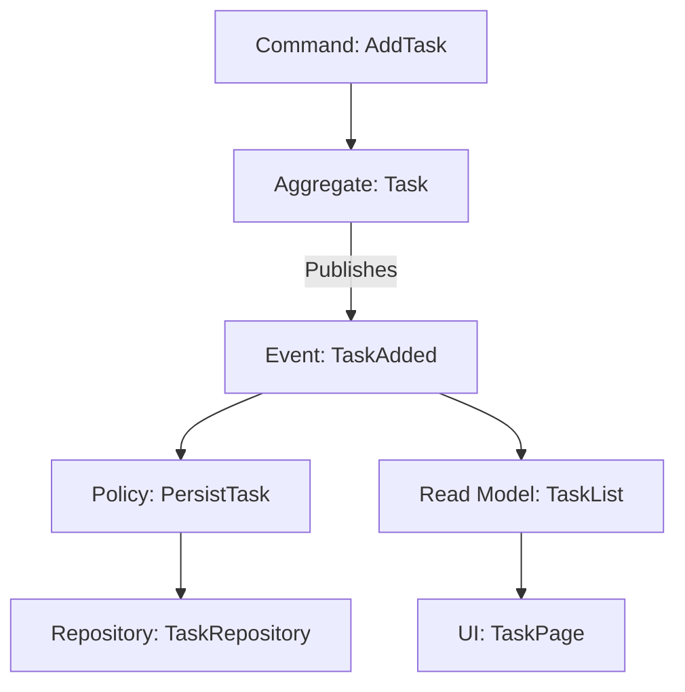

# Blueprint Interview

Greenfield entry point. Output: `docs/blueprint.md` at the project root. **No code and no specs are written here**: the factory's planner (`chantier plan <project>`) turns the blueprint into `docs/specs/spec_NNN_*.md`, each with its dependencies and its declared paths.

Interview in the user's language; write the blueprint in English unless the user asks otherwise.

The blueprint is the planner's only source of truth. Every node missing from the domain model is a feature that will not be planned; every vague word becomes a hallucination later. Interview until neither exists.

## Ground rules (same discipline as `spec-interview`)

- One question at a time. Offer 2-3 options with a recommended default (`A) ... (Recommended)`) so the user can answer with a letter.
- Challenge vague words ("simple", "fast", "secure", "manage", "handle") until they are a behavior, a number or a named example.
- "I don't know" -> propose a default and say where it comes from, in this order: 1. this repo (`CONVENTIONS.md`, existing code, `docs/`), 2. a sibling project or prior blueprint the user names, 3. a verifiable convention of the chosen stack with its one-line reason. Ask yes/no. Never claim an unverifiable "best practice".
- Do not invent facts about the market, an external API or a library version. If the design depends on one, record it under **Assumptions to validate**.
- Keep a running list of decisions and read it back at the end of each phase.

## Phase 0 - Ground yourself

1. Resolve the project root (`git rev-parse --show-toplevel`). If there is no git repo, ask whether to `git init` one: the factory needs a repo with a base branch.
2. Read `AGENTS.md` / `CLAUDE.md` / `GEMINI.md` and `CONVENTIONS.md` if they exist. If `CONVENTIONS.md` is missing, say so: the user should run `spec-conventions-interview` before or after this skill, since every spec will reference it.
3. If `docs/blueprint.md` exists, review it section by section instead of starting from a blank page.

## Phase 1 - Product

1. **Idea in one sentence**, **target user** (who, in what situation, how often).
2. **Core loop**: the 3-7 things a user does, in their words. Each becomes a command or a query later.
3. **Out of scope for v1**: ask directly; silence here is how scope creep happens.
4. **Success criterion**: one observable result that says v1 works.

## Phase 2 - Event storming (the domain model)

Walk the core loop one action at a time. For each action ask, in this order:

1. **Domain event**: what happened, in the past tense (`OrderPlaced`, not `PlaceOrder`). Reject technical events (`RowInserted`).
2. **Command**: what the user or a system asks for that produces this event, and what makes it fail (invariants: "a task title cannot be empty", "a booking cannot overlap").
3. **Aggregate**: which consistency boundary enforces those invariants. One aggregate per invariant cluster; entities live inside an aggregate.
4. **Policy**: does anything react automatically to the event ("when X happens, do Y")? Persistence, notifications and integrations are policies.
5. **Read model**: what the user needs to SEE after it (a list, a total, a status) and which events feed it.

Group aggregates into **bounded contexts** when the language changes (the same word meaning two things is the signal). Name each context. Most v1 projects have one or two.

Check before moving on: every command publishes at least one event; every event is either read by a policy or a read model, or explicitly justified; every read model is shown by some UI.

## Phase 3 - Stack and constraints

1. **Technical stack**: language, framework, persistence, test runner. Confirm versions against the repo if one exists.
2. **Technical constraints**: offline/online, backend or not, platforms, data that must stay local, performance numbers.
3. **Project structure**: the folder for each kind of node (domain, events, commands, policies, read models, infrastructure, UI, tests). This becomes the specs' declared paths, so it must be concrete.
4. **Testing stance**: BDD (Given/When/Then) for domain behavior, unit tests with mocked infrastructure for technical components, nothing for pure scaffolding. Confirm or adjust.

## Phase 4 - Write `docs/blueprint.md`

Use this structure. Telegraphic style; every identifier exact.

```markdown
# Blueprint: <Project Name>

> Written <YYYY-MM-DD> by blueprint-interview. Input of the chantier planner; read-only once planning starts.

## Product
**Idea:** <one sentence>
**Users:** <who, when, how often>
**Core loop:** <numbered list>
**Out of scope (v1):** <list>
**Success criterion:** <observable result>

## Technical Stack
- <language / framework / persistence / test runner>

## Technical Constraints
- <constraint>

## Project Structure
<tree with one folder per node kind, comment = node prefixes it holds>

## Bounded Contexts
- **<Context>**: <one line on its language and responsibility>

## Domain Model
Node prefixes: `C_` command, `A_` aggregate, `E_` entity, `DE_` domain event, `P_` policy,
`R_` repository, `RM_` read model, `DB_` infrastructure, `UI_` UI component/page.



## Invariants
- <aggregate>: <rule> -> <command that fails, and how>

## Assumptions to validate
- <assumption>
```

Then present the whole file, call out every answer you inferred rather than asked, and amend until the user accepts it.

## Phase 5 - Hand-off

1. Tell the user to commit the blueprint on the base branch: `git add docs/blueprint.md && git commit -m "docs: blueprint"`. Never commit yourself.
2. Next step, in the factory: `chantier plan <project>`. The planner proposes the specs on a branch; the user reviews them at the merge gate, then the factory implements them in dependency order.
3. Later features on the same project do not come back here: they go through `spec-interview`, exactly like a brownfield project.

## Guardrails

- Never write the blueprint before the event storming has covered every action of the core loop.
- Never put implementation details (class names, method signatures, libraries beyond the stack) in the domain model: they belong to the specs and the code.
- Never commit, branch or push.
